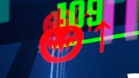

# Unicoder

PC Beat Saber mod that makes every ingame text able to show any unicode character.
When the game's own font has no glyph for a character, the mod draws it with another font.

Works on every ingame text, basegame or modded. Anywehere TextMeshPro is used.

## How it works
1. A background thread indexes the font files on the machine.
2. When text containing a character the text's font lacks is set, the best installed font that has the
   character is loaded as a *dynamic* TMP font asset and added to TMP's global fallback chain.
   TMP then renders missing characters from that font (glyphs are rasterised on demand).
3. Harmony prefixes on `TMP_Text.text` / `SetText` do this before layout (no flicker); TMP's
   `TEXT_CHANGED_EVENT` is a safety net for other ways to set text (text is rebuilt next frame).

## Fonts
Searched, in this order of preference:
1. Custom fonts manually dropped in `UserData/Unicoder/Fonts/`
2. OS fonts reported by Unity

## Limitations (TextMeshPro, not this mod)
- Emoji are drawn as monochrome outlines.
- Zero-width joiners / variation selectors are stripped from text so they don't show as boxes.

## Building
Set `BeatSaberDir` in `Unicoder.csproj.user`, then build.
References: `0Harmony` and the Unity modules.

## AI Usage Disclaimer
Some parts of this mod were coded with the assistance of Claude's Sonnet 5.5 model, those being:
- This README
- The font index that reads installed fonts' character tables to find fonts for missing characters
- The Harmony patches

Most of the mod was coded by hand, and I have personally reviewed every single line of generated code. AI was exclusively used as an assistance for stuff I had never touched before :3
